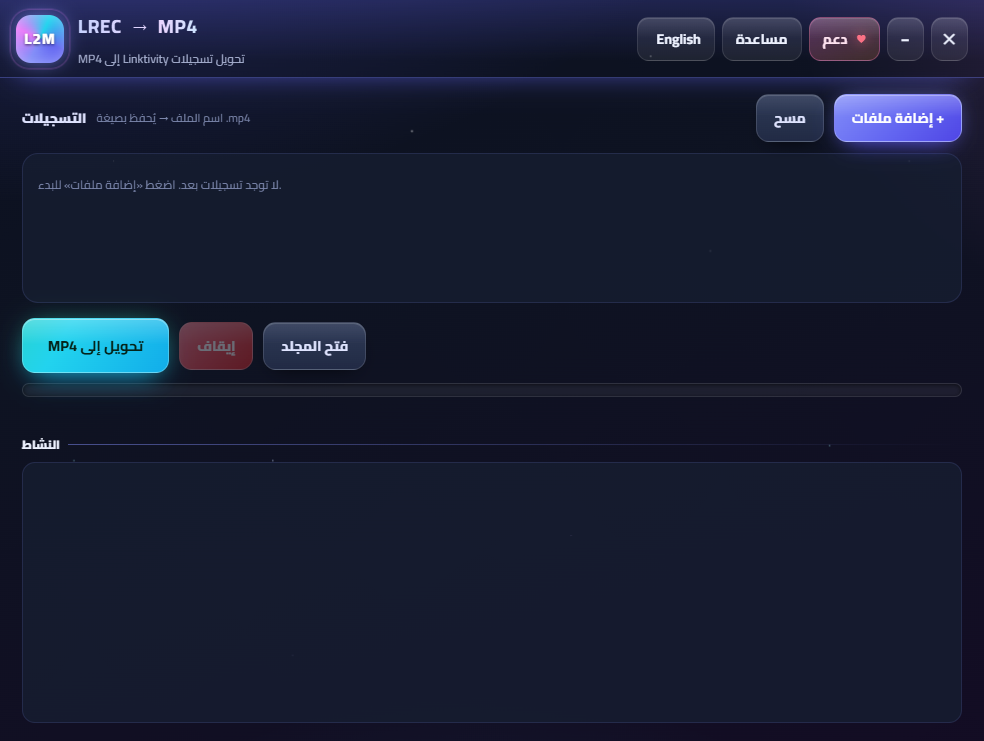

# L2M

**L2M converts Linktivity `.lrec` lecture recordings into normal MP4 files.**

It is a small Windows app built for students at the Syrian Virtual University
(SVU) who want to keep, review, and share recorded lectures without depending on
the original Linktivity player. The app is free for students and personal use,
works offline, and has no account, activation, or usage limit.



## Why L2M

SVU recordings often arrive as `.lrec` files. They play inside an old
Linktivity/Collaboration Player, which is inconvenient when you want to study on
a phone, skip around in a normal video player, or keep an archive that will still
open years from now.

Screen-recording the player works, but it is slow, captures notifications and
window chrome, and makes the result depend on the recording setup. L2M reads the
archive directly, rebuilds the screen and voice, and exports a clean MP4 with the
original timing.

Recordings are processed locally. They are not uploaded anywhere.

## What it does

- Converts one or many `.lrec` files in a single run.
- Rebuilds the original screen frames and timing.
- Decodes the voice track and keeps simultaneous speakers mixed together.
- Follows the original recorder's audio timing, so real pauses stay real.
- Works offline after installation.
- Remembers the last folders and language.
- Has a bilingual Arabic/English interface.

## Audio and video

The current version is deliberately faithful: it preserves the recording's own
timing instead of trying to make it look or sound like a different lecture.

Audio is decoded from the original voice packets and placed on the recorder's
timeline. Short waits are joined so normal speech stays continuous; longer
pauses are preserved. Video frames are rebuilt from the archive rather than
captured from the player window.

## Free for students

L2M is free for SVU students and for personal, noncommercial use. There is no
trial timer, no device activation, no account, and no feature lock. If the app
saves you time, you can star the repository, report a bug, or share it with a
classmate. That is optional.

Institutions can open an issue on the
[project page](https://github.com/qusielh/lrec-to-mp4-converter) for deployment
questions.

## Install

1. Download the latest `L2M_Setup.exe` from the Releases page of this repository.
2. Run the installer. If WebView2 is missing, the installer offers to open
   Microsoft's download page.
3. Open **L2M** from the Start menu or desktop shortcut.

The app does not require Python. WebView2 is included with most Windows 10/11
systems; if it is missing, the installer offers a download link.

## Use

1. Click **Add files** and choose one or more `.lrec` recordings.
2. Rename the output files if you want; the `.mp4` extension is added
   automatically.
3. Click **Convert to MP4**.
4. The finished files are written next to the source recordings, or in the last
   output folder you used. Use **Open folder** to find them.

The log at the bottom shows what the engine is doing and reports any file that
could not be converted.

## Build from source

Requirements:

- Windows 10 or later
- Python 3.13
- [Inno Setup](https://jrsoftware.org/isinfo.php) for the installer
- `ffmpeg.exe` and `tsdecode.exe` in `bin/`

```powershell
python -m pip install -r requirements.txt
python -m PyInstaller --clean --noconfirm L2M.spec
& "C:\Program Files (x86)\Inno Setup 6\ISCC.exe" installer\L2M.iss
```

The application is written in `l2m_ui.py`; the conversion engine is
`l2m_engine.py`; the UI lives in `ui/`. The installer output is
`dist\installer\L2M_Setup.exe`.

For a quick command-line conversion:

```powershell
python l2m_cli.py recording.lrec recording.mp4
```

## Project layout

```text
l2m_ui.py          desktop shell and Python/JS bridge
l2m_cli.py         command-line converter
l2m_engine.py      .lrec parser, frame reconstruction, audio decode, MP4 mux
ui/                HTML/CSS/JS interface
installer/         Inno Setup script
assets/            icon and screenshot
bin/               ffmpeg and TrueSpeech decoder (not committed)
```

## License

L2M is source-available under the
[PolyForm Noncommercial License 1.0.0](LICENSE). You may use, study, modify, and
share it for noncommercial purposes. Commercial redistribution, resale, or
bundling into a paid product requires a separate license. Institutional
deployment and support can be arranged separately through the project page.

The bundled ffmpeg and TrueSpeech decoder remain under their own licenses; see
the files in `bin/` and their upstream projects for details.
